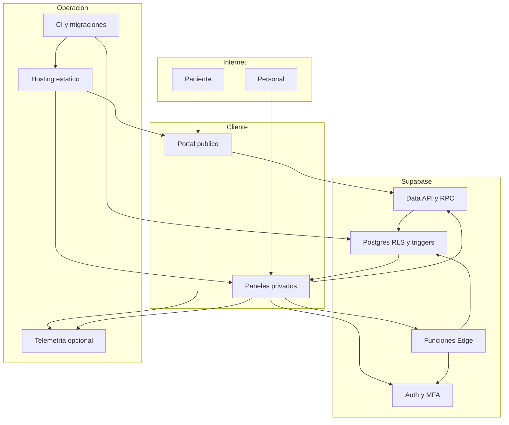

## Executive summary

El producto sigue en desarrollo y se orientará a un SaaS de consultorios; la cafetería posiblemente se retirará. Los riesgos principales son abuso de entradas públicas, rebaja de MFA desde una sesión de dueño comprometida y operaciones que separan datos de su evidencia. Hay aislamiento y autorizaciones de base sólidamente representados en pruebas, pero faltan garantías de contexto de cliente, atomicidad y auditoría de lectura. No se demostró una fuga entre clínicas. S01 y S02 del informe de seguridad se reprodujeron con roles anon/authenticated en PostgreSQL desechable.

## Scope and assumptions

Contexto validado con el propietario el 21 de octubre de 2026: sin producción ni pacientes reales en operación declarada; el consultorio continúa, café es prescindible y la prioridad comercial es renta SaaS con posible venta.

Supuestos de despliegue futuro: portal accesible por Internet; Auth/PostgREST y funciones Edge de Supabase; clínicas comparten infraestructura con segregación por tenant; expediente contiene datos sensibles de salud; personal accede desde navegadores. Docker y Vercel son destinos documentados, no despliegues inspeccionados.

Incluye `src/`, migraciones, funciones Edge, CI, scripts de migración y contenedores. Excluye infraestructura efectiva del proveedor, secretos, endpoints de producción, pentest externo, revisión jurídica y explotación de dependencias. Falta confirmar dominio/routing por tenant, volúmenes, política de backup/recuperación y destinatario de telemetría; afectan exposición y prioridad operacional.

## System model

### Primary components

- SPA React/Vite: portal, panel administrativo y de especialista (`src/App.jsx`, `src/user/`, `src/admin/`, `src/doctor/`).
- Supabase Auth: credenciales, recuperación, invitaciones y TOTP (`src/auth/authService.js`).
- PostgREST/RPC + PostgreSQL: catálogos, agenda, expediente, consentimientos y cobros, bajo RLS y triggers (`src/api/`, `migrations/`).
- Edge Functions con service role: invitación y sincronización de especialistas (`supabase/functions/`).
- Realtime: cambios de pedidos (`src/hooks/useSupabaseCrud.js:209`).
- Analítica opcional: dataLayer o sendBeacon a destino configurado (`src/monitoring.js`).
- Herramientas de entrega: npm, GitHub Actions, Vite, migrador SQL, nginx estático (`.github/workflows/ci.yml`, `Dockerfile`, `scripts/migrate.sh`).

### Data flows and trust boundaries

- Internet → SPA pública: rutas, query strings, datos de reserva/ARCO/pedidos por HTTPS esperado en despliegue. Validación de formularios aporta UX; no es autoridad de permisos.
- Navegador → Auth: correo, contraseña, token y desafío TOTP. El proveedor firma tokens; configuración real de rate limits y políticas no inspeccionada.
- Navegador → PostgREST/RPC: JWT o API pública, `x-tenant-id`, contacto, comandos y consultas. RLS verifica membresía activa; triggers validan precios, agenda e inmutabilidad. La cabecera es propuesta, no prueba de acceso (`migrations/0035_access_hardening.sql:64`).
- Navegador → Edge → administración Auth/DB: petición autenticada e identidad del tenant; la función valida owner en tabla y usa service role. Ese privilegio exige verificación explícita en cada rama; CORS no reemplaza autorización.
- PostgreSQL → Realtime → navegador: eventos de pedidos por tenant y recarga de datos. La UI debe invalidar respuestas de un contexto anterior.
- Navegador → telemetría opcional: eventos y mensajes de error; sendBeacon y CSP. Necesita contrato de minimización para no sacar datos sensibles.
- Desarrollador/CI → build/migrador: dependencias, código y SQL; privilegios administrativos de despliegue. Las pruebas SQL usan una base desechable marcada, diferente de una instalación clínica.
- Interfaz → WhatsApp/correo: el paciente o personal abre enlaces y mensajes; el envío operativo de notificaciones clínicas no está acreditado en el árbol revisado. No modelar una cola como si ya existiera un trabajador de entrega.

#### Diagram

## Assets and security objectives

| Asset | Why it matters | Security objective (C/I/A) |
|---|---|---|
| Notas, pacientes, tutores y citas | Daño a privacidad e integridad de atención | C/I/A |
| Membresías y factores MFA | Evitan apropiación de cuentas y privilegios | C/I |
| Disponibilidad de agenda | Capacidad de atender y generar ingreso | I/A |
| Consentimientos y auditoría | Evidencia atribuible de acciones y decisiones | I/A/C |
| Cobros e historial | Integridad de saldos y conciliación | I/A |
| Service role y credenciales administrativas | Alcance potencial de todas las clínicas | C/I |
| Artefactos y migraciones | Estado reproducible de cada instalación | I/A |

## Attacker model

### Capabilities

Visitante puede inspeccionar el bundle público, conocer tenant/IDs de catálogo, hacer peticiones directas y controlar campos admitidos por API, enviar solicitudes concurrentes y usar contactos inventados. Personal malicioso puede llamar rutas autorizadas sin la UI. Una cuenta de dueño comprometida a nivel contraseña puede obtener AAL1 y actuar donde no se exija AAL2. Contenido en logs, nombres y formularios es no confiable.

### Non-capabilities

No se presupone acceso inicial a service role, consola Supabase, CI, llave de firma JWT ni superusuario PostgreSQL. No se presupone un XSS o RCE: no se demostró. Una cabecera de tenant arbitraria no implica por sí sola acceso a una clínica ajena. Tampoco se asume que un owner pueda leer notas reservadas al autor.

## Entry points and attack surfaces

| Surface | How reached | Trust boundary | Notes | Evidence (repo path / symbol) |
|---|---|---|---|---|
| Reservas públicas | INSERT por Data API | Anónimo → DB | Campos y rate limit relevantes | `src/api/appointments.js:69`; `migrations/0037_booking_request_limits.sql` |
| Pedidos y ARCO | Data API | Anónimo → DB | Café se puede retirar; ARCO continúa | `migrations/0005_policies_by_tenant.sql:412`; `migrations/0039_compliance.sql:182` |
| Sesiones/MFA | Auth y RPC | Cuenta → privilegios | Exigencia en base, rebaja sensible | `src/auth/authService.js`; `set_clinical_mfa` |
| Lectura clínica | SELECT/RPC | Especialista → DB | Lectura y registro desacoplados | `src/api/clinical.js:31-63` |
| Gestión de accesos | Funciones Edge | Owner → service role | Recuperación de MFA y temporales | `supabase/functions/invite-staff/index.ts` |
| Cambio de sesión/tenant | Estado React | Contextos de usuario | No toda caché está identificada por contexto | `src/hooks/useSupabaseCrud.js:182` |
| Telemetría | Eventos y errores | Navegador → receptor | Receptor opcional, CSP limita | `src/monitoring.js:17-30` |
| Desarrollo/CI/migración | CLI y workflow | Código → herramientas privilegiadas | Dependencias avisadas y script no ejecutable | `package-lock.json`; `.github/workflows/ci.yml` |

## Top abuse paths

1. Bloquear agenda más allá del plazo → visitante envía `created_at` futuro → la expiración usa ese valor → horario solicitado conserva su reserva fuera de las 24 horas previstas. Reproducido.
2. Evadir topes → visitante retrofecha solicitudes → contadores las ignoran → crea más solicitudes/pacientes de lo que permiten los topes por contacto. Reproducido.
3. Rebajar protección → atacante obtiene contraseña de owner → invoca RPC con AAL1 → desactiva MFA clínica → futuros accesos permitidos por rol ya no necesitan segundo factor. Reproducido; no concede permisos de notas adicionales.
4. Omitir trazabilidad → especialista autorizado hace SELECT de sus notas → no llama la RPC de auditoría → obtiene lectura sin la huella que promete el flujo. Confirmado estáticamente.
5. Dañar consistencia → falla de red o línea inválida entre peticiones de pedido/reserva → primera escritura persiste y evidencia/detalle falla → operador ve una realidad distinta y puede reintentar. Es un modo de fallo de integridad; no requiere atacante.
6. Contaminar identidad → visitante usa correo ajeno conocido → trigger enlaza paciente por contacto no verificado → personal podría asociar atención futura a la identidad incorrecta si no verifica. Hipótesis de abuso de proceso, no fuga de lectura demostrada.
7. Sacar contexto por observabilidad → error incluye dato no previsto → receptor analítico configurado acepta evento → información sale de su frontera clínica. Condicional; no se observó envío real.
8. Afectar entorno de desarrollo → entrada adecuada alcanza tooling vulnerable o dev server expuesto → disponibilidad/archivos/comandos según el aviso y plataforma → daño al entorno técnico. No se explotaron avisos ni se trasladó su severidad al nginx estático.

## Threat model table

| Threat ID | Threat source | Prerequisites | Threat action | Impact | Impacted assets | Existing controls (evidence) | Gaps | Recommended mitigations | Detection ideas | Likelihood | Impact severity | Priority |
|---|---|---|---|---|---|---|---|---|---|---|---|---|
| TM-001 | Anónimo | API pública activa | Manipular sello temporal | Evasión de topes/caducidad | Agenda, pacientes | Topes y EXCLUDE, migraciones 0017/0037 | `created_at` controlable | Sello server e inmutabilidad; serializar límites | Fechas imposibles y ráfagas | high | high | high |
| TM-002 | Credencial owner robada | Sesión AAL1 | Apagar MFA | Rebaja de protección | Pacientes, accesos | Rol en tabla; RLS clínica, 0035/0039 | AAL2 solo al encender | AAL2 para rebajar y recuperación separada | Alerta de cambios MFA | medium | high | high |
| TM-003 | Especialista malicioso | Acceso legítimo a sus notas | SELECT sin registrar lectura | Huella incompleta | Expediente, auditoría | RLS autor/tenant, 0013; RPC audit, 0022 | Registro posterior del cliente | Lectura auditada en servidor sin SELECT paralelo | Correlación lecturas/eventos | medium | medium | medium |
| TM-004 | Anónimo o error de operación | Coincidencia de contacto | Vincular cita a identidad no verificada | Contaminación de expediente | Pacientes y notas futuras | No sobreescritura pública, 0034/0038 | Correo/nombre no acreditan identidad | Verificación administrativa antes de encuentro; conciliación y trazabilidad | Duplicados/disputas de identidad | medium | high | medium |
| TM-005 | Red/falla o carrera | Operación de varias peticiones | Interrumpir guardado | Datos parciales/reintentos | Citas, consentimientos, pedidos | Rollback UI; triggers de precio | Sin transacción conjunta | RPC atómica, idempotencia y conflictos de versión | Fallos parciales y duplicados | high | high | high |
| TM-006 | Sesión/contexto anterior | Misma capacidad entre contextos | Usar respuesta/borrador obsoleto | Exposición local o registro erróneo | Datos de tenant | RLS servidor y canal filtrado | Recarga no depende de identidad/tenant | Clave de contexto e invalidación de respuestas | Contexto de petición y acción | medium | high | medium |
| TM-007 | Datos en error | Analítica habilitada y permitida | Exportar mensaje libre | Pérdida de minimización | PII/contexto de salud | CSP restringe destino | Sin contrato/redacción central | Códigos y campos permitidos | Pruebas sintéticas y revisión de eventos | low | high | medium |
| TM-008 | Entrada no confiable de tooling | Dev server/procesador alcanzable | Activar aviso de dependencia | Daño a desarrollo/CI | Código y artefactos | Lockfile; runtime estático separado | Vite/source-map-js avisados | Actualizar y validar, aislar dev/CI | Audit y alertas de dependencia | medium | medium | medium |

## Criticality calibration

- **critical:** acceso masivo entre clínicas o escritura administrativa global sin control. Ejemplos de criterio, no hallazgos: service role expuesta; SELECT anónimo de todos los expedientes; RCE en backend con privilegios globales.
- **high:** abuso remoto que degrada agenda o integridad de registros, o rebaja de una protección clínica relevante con credencial parcial. Ejemplos observados: TM-001 y TM-002; datos parciales en operaciones críticas TM-005.
- **medium:** requiere rol legítimo, transición poco frecuente o configuración adicional; impacto acotado o trazabilidad incompleta. Ejemplos: omitir log de lectura propia; telemetría condicional; caché local en cambio de contexto sin bypass de RLS probado.
- **low:** detalles sin efecto demostrado en confidencialidad/integridad o exposición muy limitada. Ejemplos de criterio: mensajes técnicos sin datos sensibles; metadatos públicos esperados; defecto cosmético sin engaño operacional. No inflar cada caso a vulnerabilidad.

Como no hay producción, urgencia actual significa impedir que estos fallos lleguen al piloto. Si cambia la exposición, el volumen o los datos reales, recalibrar. No se ha certificado ausencia de fallos más graves.

## Focus paths for security review

| Path | Why it matters | Related Threat IDs |
|---|---|---|
| `migrations/0037_booking_request_limits.sql` | Sellos, topes y concurrencia | TM-001 |
| `migrations/0036_booking_requests.sql` | Caducidad y estado público | TM-001 |
| `migrations/0039_compliance.sql` | MFA y evidencia de consentimiento | TM-002, TM-005 |
| `migrations/0038_minor_bookings_busy_slots.sql` | Asociación de paciente/tutor | TM-004 |
| `src/api/appointments.js` | Reserva y consentimiento separados | TM-005 |
| `src/api/orders.js` | Escrituras parciales y precio | TM-005 |
| `src/api/clinical.js` | Contrato de lectura auditada | TM-003 |
| `src/hooks/useSupabaseCrud.js` | Identidad de contexto y respuestas tardías | TM-006 |
| `src/auth/authService.js` | Selección de clínica y sesiones | TM-002, TM-006 |
| `supabase/functions/invite-staff/index.ts` | Administración Auth con service role | TM-002, TM-008 |
| `supabase/functions/sync-doctor-access/index.ts` | Identidad y privilegios entre clínicas | TM-006, TM-008 |
| `src/monitoring.js` | Frontera de salida de eventos | TM-007 |
| `package-lock.json` | Tooling avisado y versiones | TM-008 |
| `scripts/migrate.sh` | Despliegue del estado de seguridad | TM-005, TM-008 |

## Notes on use

Cobertura: entradas públicas/privadas, Auth/MFA, Edge, datos y contexto, eventos y cadena de entrega. Se separaron amenazas de runtime y tooling. El contexto de desarrollo/SaaS y la posible salida del café fueron confirmados por el propietario antes de cerrar este modelo. El diagrama describe el diseño del repo; no acredita un despliegue inspeccionado. La recuperación, los proveedores efectivos y el dominio siguen abiertos.

La evidencia SQL adicional está en `evidence/additional-security-checks.sql`, protegida por una marca de base desechable y dependiente de fixtures. Los controles SQL actuales pasan, pero hay fallos fuera de sus expectativas. Tratar las reproducciones como base para nuevas pruebas que rechacen el comportamiento inseguro, no como aprobación de ese comportamiento.
